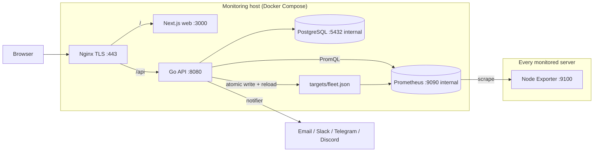

# BM Monitor — Architecture and Decisions

Source plan: Notion "BM Monitoring & Cost Management Platform: Build Plan".
This file records what inspection found, the decisions taken, and where the
implementation deliberately differs from the plan.

## 1. Inspection report (Phase 0, 2026-10-15)

| Item | Finding |
|------|---------|
| Repository | `Server_management/` was empty (no files, not a git repo). Initialised as a new repo. |
| Existing Go controller | **None found** in this workspace or sibling folders (those contain unrelated projects: Puku, pandastack, Temporal/Sentry). |
| Existing DB / migrations / tests / Docker | None. |
| Toolchain on the dev machine | Go 1.27.1, Node 25.9, Docker CLI + Compose v5.5 (daemon **not running**), no C compiler (`CGO_ENABLED=0`), no `psql`. |

Consequences:

- There is no existing collector to preserve, so the default from the plan applies:
  **Prometheus is the only scraper**; the Go API owns the inventory and writes
  Prometheus targets. No competing collector exists.
- If an existing controller repo turns up later, it must be reviewed before
  Phase 2 is finalised (see section 2.3 of the plan): it either becomes the
  collector (exposing `/metrics` to Prometheus) or the inventory manager, never both
  scraping the same hosts.
- `sqlc` needs cgo for its PostgreSQL parser, so it cannot be built here. Queries are
  hand-written with `pgx/v5`, always parameterised. This can be swapped for `sqlc`
  later without changing the schema.
- Integration tests use a real PostgreSQL: `TEST_DATABASE_URL` if set, otherwise an
  embedded PostgreSQL downloaded by the test helper. Docker is not required to run them.

## 2. Architecture

- **PostgreSQL** is the source of truth for inventory, pricing, users, rules, alerts, audit and settings.
- **Prometheus** holds every raw metric sample. Raw samples are never copied into PostgreSQL.
- **Go API** is the only path to data. The browser never reaches Prometheus or PostgreSQL.
- `server_id` (UUID) is the join key between Prometheus series and PostgreSQL rows.

## 3. Decisions that differ from, or tighten, the Notion plan

| # | Plan said | Decision | Why |
|---|-----------|----------|-----|
| D1 | Write the exporter host into `fleet.json` | Write the **resolved, validated IP**; keep the hostname as a label | Prometheus would otherwise resolve the name again later, which bypasses the SSRF guard (DNS rebinding). |
| D2 | `server_pricing` exclusion on `(server_id, plan_id)` | **One primary plan per server at a time** (exclusion on `server_id` + range). Extra per-server charges go in `fixed_costs`, which may now be scoped to a server, a group or the fleet. | Makes "assigning a plan ends the previous one" well defined and stops a server being double-charged by accident. |
| D3 | `scrape` Docker network | The `internal` network is `internal: true` (no egress). Only Prometheus and the API join the `egress` network. | A plain bridge network does not isolate anything. |
| D4 | Health checks via `wget` | The API binary has a `healthcheck` subcommand | The runtime image is distroless and has no shell or wget. |
| D5 | `listen 443 ssl http2` | `http2 on;` plus a strict Content-Security-Policy | The old form is deprecated in Nginx ≥ 1.25, and the CSP was in the checklist but missing from the config. |
| D6 | `sqlc` | Hand-written `pgx` queries | No cgo toolchain here (see section 1). |
| D7 | Next.js 15 | Next.js 16 (current stable) | New project, so start on the supported major version. |
| D8 | Alerts and incidents | An `alerts` row **is** an incident instance (one per fingerprint while open). Its history is the closed rows. | Avoids a second table holding the same lifecycle. |
| D9 | Session ids "stored hashed" | SHA-256 of a 32-byte random token is the primary key. CSRF token = HMAC(`CSRF_SECRET`, session token). | Nothing secret is stored, and CSRF needs no extra table. |
| D10 | Login rate limit | In-memory per-IP limiter plus a per-account lockout counter stored in `users` | The account lock survives restarts. The IP limiter is in-memory because there is one API instance. |
| D11 | API calls `POST /-/reload` after writing targets | No reload, and no `--web.enable-lifecycle` | File-based discovery watches the file itself, and the lifecycle flag would also expose `/-/quit` on the internal network. Measured locally: a disabled server leaves Prometheus's active targets within about 2 s. |
| D12 | Per-plan currencies | One billing currency per installation (`BILLING_CURRENCY`); plans, fixed costs and imports must match it | No currency conversion is ever guessed. |
| D13 | Plans editable | A plan's amount, unit and category lock once it has been assigned; a price change is a new plan assigned from a date | Past months never change after the fact. |
| D14 | `server_pricing` only | A new `server_activity` table records enabled, non-deleted periods | "Hours the server was enabled" must be exact for proration, and audit events are not a reliable clock. |
| D15 | — | The disk-forecast rule needs at least 2 h of history per filesystem | Found with real data: a linear fit over minutes of writes predicted "full within 24 h" on healthy disks. |
| D16 | shadcn/ui | Small hand-built Tailwind components (`web/components/ui.tsx`) | Avoids a generator step for about 10 primitives. Same tokens, accessible dialogs (native `<dialog>`), keyboard focus rings. |
| D17 | Zod for every response | Zod schemas for the dashboard's core responses (fleet, servers, server detail, history, alerts, costs, insights); admin screens use typed fetches | Covers every number that is charted or summed. |

## 4. Phases and acceptance

| Phase | Scope | Done when |
|-------|-------|-----------|
| 1 Foundation ✅ | Layout, config, migrations (all tables), auth core (sessions, CSRF, roles, first admin), health/readiness, logging, graceful shutdown, Compose, Nginx, Prometheus config | API unit and integration tests pass; migrations up/down/up on an empty DB; `docker compose config` is valid |
| 2 Monitoring ✅ | Server CRUD, groups, labels, SSRF guard, validate endpoint, audit, targets writer + reload + reconcile, PromQL layer, fleet summary, server detail, metrics history | A server added via the API is scraped within 1 min; disabling it removes it from targets; a dead server shows offline without blocking the rest |
| 3 Frontend ✅ | Shell, login, overview, servers table + drawer, server detail charts, all five page states | Every number traces to an API call; responsive; keyboard usable |
| 4 Cost ✅ | Plans, effective-dated assignment, fixed costs, cost engine, summary/trend, nightly closer, CSV import, Costs page | Proration, rounding, timezone and missing-pricing tests pass |
| 5 Alerts & insights ✅ | Rules, evaluator, lifecycle, notifier, disk forecast, cost increase, underutilisation, comparisons | One notification per incident; ack stops reminders; recovery resolves |
| 6 Hardening ✅ (deploy pending) | SSO (optional), rate limits on every abuse path, security checklist, backups/restore drill, load test, docs | Section 17 of the plan is fully ticked |

## 5. Monitoring host inspection (read-only, 2026-10-15)

Host `bm2`, 51.38.55.124. Inspected over SSH with read-only commands only (no sudo, no changes).

| Item | Finding | Consequence |
|------|---------|-------------|
| OS | Ubuntu 24.04.4 LTS, kernel 6.8, up 31 days | Supported. |
| Hardware | Xeon E5-1650 v4 (6C/12T), 62 GiB RAM, 410 GB RAID1 root (26 % used) | Ample for the stack. Give containers memory limits so they never starve the other workloads. |
| Docker | Docker 29.8.2 + Compose v5.6 already installed; `ubuntu` is in the `docker` group; no containers running | Nothing to install. Deploy as `ubuntu` with no sudo for Compose itself. |
| Other workloads | `puku-workerd.service` running; a 50 GB Ceph OSD LV (`vg_cephosd`); ZFS event daemon | Shared host: the stack must coexist, using its own Compose project name, networks and volumes. |
| Ports in use | TCP 22 only (plus local DNS); UDP 51820 (WireGuard) | 80, 443, 3000, 8080, 9090 and 9100 are free. |
| **WireGuard** | `wg0` = **10.0.0.12/24** | **Scrape over WireGuard, not the public internet.** Node Exporter listens on the wg address only, `ALLOWED_TARGET_CIDRS=10.0.0.0/24`, and port 9100 is never exposed publicly. This supersedes the public-IP plan in section 7, row 2, if every monitored server is on this WireGuard network. |
| Firewall | ufw active (rules readable by root only, not inspected) | Rules for 80/443 and for Docker → host 9100 will be needed; to be shown to the owner before any change. |
| Time | chrony, NTP synchronised, UTC | Good for status and charts. |
| Access | `ubuntu` has full sudo (password required) | Any change requires the owner's explicit approval. |

## 6. How a server is added (agreed scope)

Adding a server in the UI takes its **IP address and Node Exporter port**, never SSH
credentials. The app does not store SSH passwords or keys and never runs commands on
servers (plan section 13). Node Exporter is installed once per server by an admin over
SSH with `deploy/node-exporter/install.sh`. If automatic installation from the UI is
wanted later, it needs its own separately authorised design (key-based, audited, opt-in).

## 7. Questions and answers

| # | Question | Answer (2026-10-15) | Effect on the build |
|---|----------|---------------------|---------------------|
| 1 | Existing Go controller repo? | **No** | Greenfield. Prometheus is the only scraper; the Go API is the inventory manager. Final. |
| 2 | Where does the monitoring app run, and what IP ranges do the servers use? | **The app runs on the bare-metal server 51.38.55.124 (Ubuntu). Monitored servers have public IPs like that one.** | `ALLOWED_TARGET_CIDRS` lists each server's public IP as a `/32` (starting with `51.38.55.124/32`). Because exporters are reachable over the internet, Node Exporter basic auth + TLS (plan section 3.6) is **required**, not optional, and port 9100 is firewalled to the monitoring host only. The host monitors itself through its public IP; its firewall must also allow the Docker bridge range to reach 9100. |
| 3 | Real prices and currency | **Maybe later** | Cost pages show "Pricing not configured" until plans are entered in Settings. No price is ever assumed. |
| 4 | Where alert messages are sent first | **Email via Gmail** | Gmail SMTP (`smtp.gmail.com:587`, STARTTLS) with a Google **app password** is the first channel, built in Phase 5 and tested end to end. The address and app password live only in `.env` on the server. The notifier stays channel-agnostic. |
| 5 | Local login or Google SSO? | **Both** | Local email/password from Phase 1. Google SSO (`GOOGLE_CLIENT_ID/SECRET`, `GOOGLE_ALLOWED_DOMAIN`) in Phase 6; SSO users may have a null password. |
| 6 | Billing API or CSV upload? | **Maybe** | CSV import is built (Phase 4). Provider APIs (Hetzner, OVH) stay optional adapters, enabled only if their credentials are set. Without either, only *estimated* cost is shown. |

## 8. Status, verification and limitations (2026-10-15)

All six phases are implemented. They run locally with
`docker compose -f docker-compose.yml -f docker-compose.local.yml up -d --build`.

### Test results (actually run)

| Suite | Result |
|---|---|
| Go unit + integration (`go test ./...`, real PostgreSQL 17) | **47 top-level tests passed, 0 failed**: config, auth, migrations up/down/up, constraints, SSRF guard, registration, targets file, status rules, sorting/paging, history gaps, cost formulas (proration, price change, timezone edges, leap year, rounding, allocation, missing pricing), alert lifecycle (pending, fire once, ack stops reminders, flap guard, resolve, Prometheus-down), roles on every protected action, settings, audit |
| Frontend unit (Vitest) | **24 passed**: formatters (missing data is never 0), API client (CSRF header, typed errors, schema mismatch), status and severity badges (never colour alone), page states, meter, pagination |
| Frontend lint and types | ESLint 0 problems; `tsc --noEmit` clean; production `next build` OK |
| End to end (Playwright, real Chromium, running stack) | **8 passed**: login redirect and error, live overview numbers equal the API, servers table and sort, detail charts and ranges, add-server check, duplicate and SSRF refusal in the UI, costs/alerts/insights/settings, mobile 390 px without horizontal scroll, dark theme |
| Live stack checks | All services healthy; 3 lab exporters registered through the API went online 26 s later with no rebuild; disable/enable removes and restores the Prometheus target within about 2–6 s; Prometheus and PostgreSQL publish no host ports; security headers present; email channel test delivered through Gmail SMTP |

### Known limitations and production-readiness tasks

1. **Not yet deployed to bm2.** The server is read-only until the owner approves the steps in the RUNBOOK (deploy, TLS, firewall rules).
2. **No real servers monitored yet.** Node Exporter must be installed on each server, and the WireGuard membership of the fleet must be confirmed (open question 2).
3. **No pricing entered.** Cost pages correctly show "Pricing not configured" until plans are added.
4. Google sign-in is implemented but untested against Google, because no OAuth client id has been provided.
5. Provider billing APIs (Hetzner, OVH) are not implemented; actual costs come from CSV import.
6. The load test with 500 servers (plan section 15) has not been run. The design keeps it cheap: about a dozen fleet-wide PromQL queries regardless of fleet size, cached for 10 s, and sorting and paging in memory over the inventory.
7. Single API instance: the login and registration rate limiters are in-memory. The notifier already uses `FOR UPDATE SKIP LOCKED`, so it is safe with several instances.
8. Backups are documented, not scheduled: add the cron entry from the RUNBOOK on the host.
